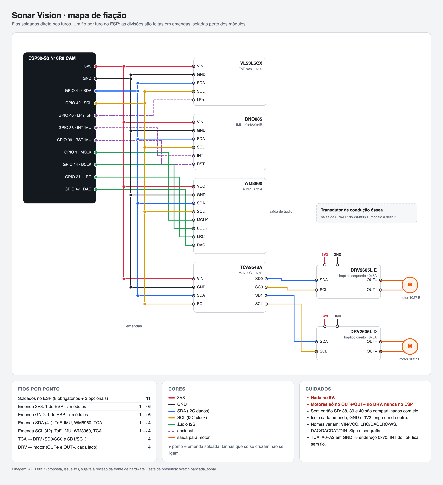

# Mapa de fios da bancada

Pinagem definida por Bryan em 05/11/2026 para as #1/#17/#18, conforme
[ADR 0028](decisions/0028-pinagem-bancada.md). Implementação e ensaio físico:
Mathias, Tarcísio e Weslley. Este registro transcreve o mapa informado; não é
resultado de medição elétrica ou teste de firmware.

## Conexões definidas

| ESP32-S3 N16R8 CAM | Destino no mapa |
|---|---|
| 3V3 | Alimentação dos módulos pelo barramento de emendas |
| GND | Referência comum dos módulos |
| GPIO41 | SDA de VL53L5CX, BNO085, WM8960 e TCA9548A |
| GPIO42 | SCL de VL53L5CX, BNO085, WM8960 e TCA9548A |
| GPIO40 | LPn do VL53L5CX; fio indicado como opcional no mapa |
| GPIO38 | INT do BNO085; fio indicado como opcional no mapa |
| GPIO39 | RST do BNO085; fio indicado como opcional no mapa |
| GPIO1 | MCLK do WM8960 |
| GPIO14 | BCLK do WM8960 |
| GPIO21 | LRC do WM8960 |
| GPIO47 | Entrada de dados de áudio rotulada DAC no WM8960 |

O nome DAC nessa conexão é o rótulo da entrada serial de áudio no mapa, não
uma instrução para usar uma saída analógica do ESP. Conferir a serigrafia da
placa e o guia do codec antes de escrever o driver.

| TCA9548A | Destino |
|---|---|
| SD0 / SC0 | SDA / SCL do DRV2605L esquerdo |
| SD1 / SC1 | SDA / SCL do DRV2605L direito |
| A0 / A1 / A2 | GND, conforme anotação do mapa |

Cada DRV recebe alimentação e GND comuns; OUT+ e OUT− vão somente ao motor
daquele lado. O transdutor de condução óssea está representado na saída de
áudio do WM8960, mas o mapa não define terminais SPK/HP exatos nem modelo do
transdutor. Não escolher esses terminais silenciosamente.

Endereços indicados pelo mapa, de 7 bits: VL53L5CX 0x29, BNO085 0x4A/0x4B,
WM8960 0x1A, TCA9548A 0x70 e cada DRV2605L 0x5A em seu ramal. Conferir presença
em bancada; não tratar a figura como resultado de um scan I2C.

## Montagem e limites do registro

Um fio por furo no ESP; derivações em emendas isoladas próximas aos módulos.
Pontos representam ligação; cruzamentos sem ponto não representam contato.
O mapa orienta não usar 5 V nesses barramentos e não ligar motores ao ESP.
Ele não substitui a conferência das tensões aceitas pelas placas exatas,
pull-ups, consumo, corrente de partida, continuidade e ausência de curto.

O mapa prevê uso sem cartão SD, indicando compartilhamento dos GPIO38/39/40.
Não habilitar SD nem alterar a câmera sem revisar conflitos com esta pinagem.
A pinagem da OV2640 no conector da placa não está desenhada aqui; usar o
mapeamento da placa adquirida, sem copiar de outra ESP32-CAM.

A figura cita “ADR 0027 (proposta)” no rodapé. Esse texto está desatualizado:
a confirmação desta pinagem está no ADR 0028; o ADR 0027 do repositório trata
do acesso ao painel. O nome “bancada_sonar” aparece como referência na imagem,
mas nenhum sketch com esse nome foi localizado neste checkout.

## Integração do ESP com a nuvem

Para o papel dos componentes, setores ToF e acionamento independente das
hastes, seguir as [orientações de firmware](firmware-integration.md).

Seguir o [guia de envio de distância e JPEG](esp-api-guide.md), com URLs,
headers, exemplos, sessão de boot, TLS e respostas. É possível começar somente
com a distância e integrar a câmera depois. Credenciais são entregues por meio
privado. O alerta tátil local precisa funcionar também com a VM desligada.
